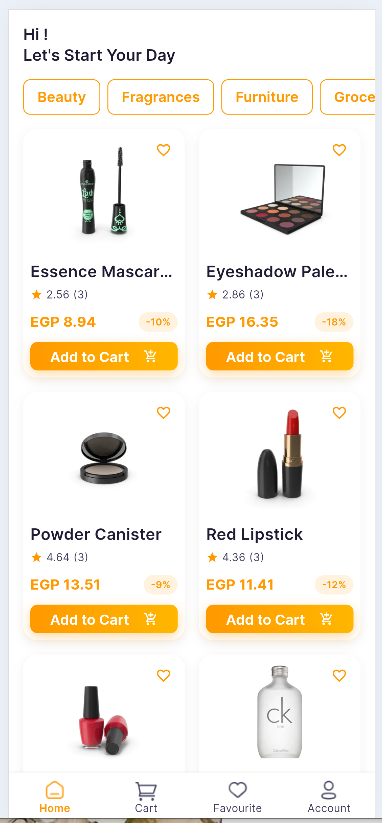
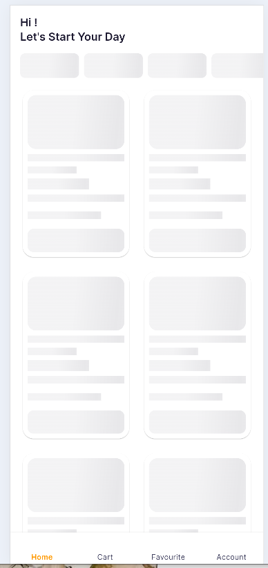
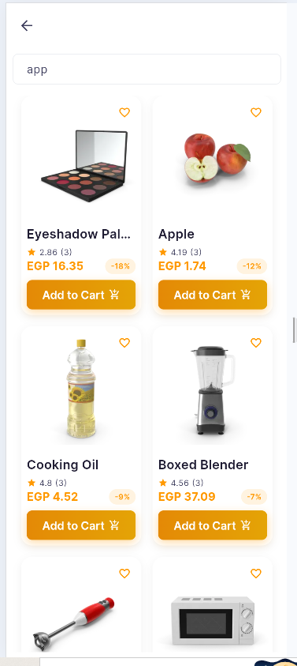
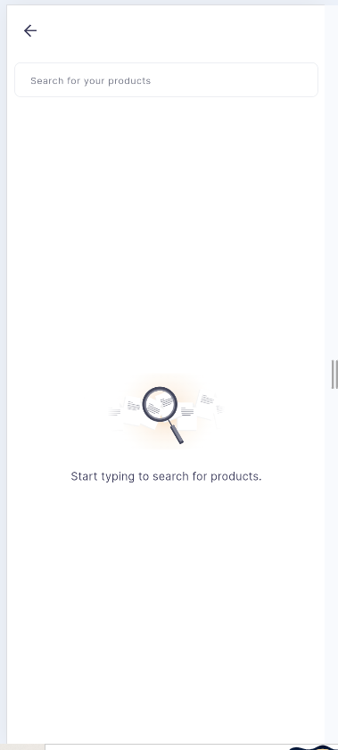
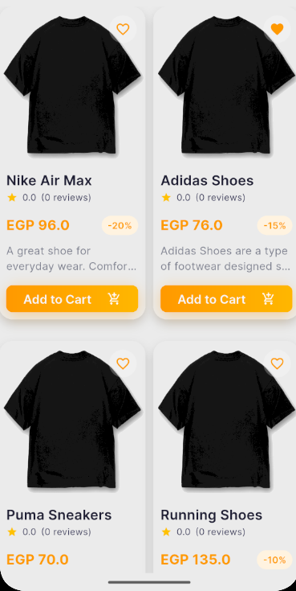
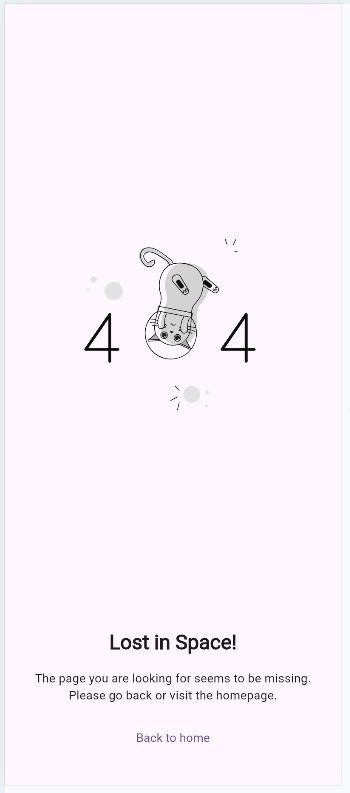
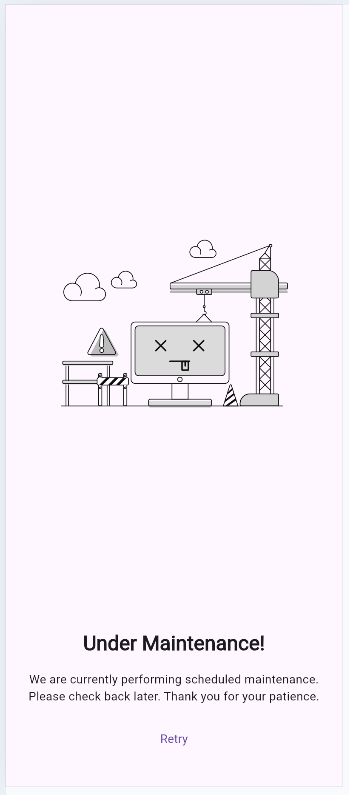
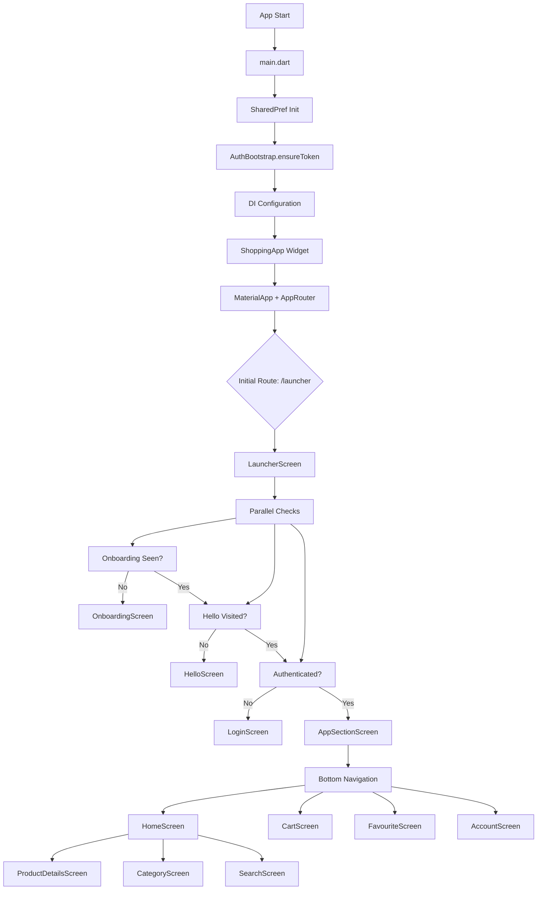

# Shopping App

A feature-rich Flutter e-commerce application built with clean architecture principles, demonstrating modern Flutter development practices including BLoC state management, dependency injection, and REST API integration.

## Technology Badges


## Overview

Shopping App is a complete e-commerce mobile application that provides users with a seamless shopping experience. The app follows a feature-first architecture with clear separation of concerns across domain, data, and presentation layers. It integrates with a RESTful backend API for product catalog, authentication, cart management, and user profiles.

**Target Users:** Mobile shoppers looking for a modern, responsive e-commerce experience.

---

## Screenshots

| Screen | Preview |
|--------|---------|
| Launcher / Splash |  |
| Onboarding |  |
| Hello / Welcome |   |
| Home (Loading) |  |
| Home (Success) |  |
| Search |  |
| Start Search |  |
| Product Card |  |
| Error / 404 |  |
| Under Maintenance |  |

*Additional demo assets available in `assets/placeholder/` (GIF animations for ecommerce flow and add-to-cart).*

---

## Features

### Authentication & User Accounts
- **User Registration** – Email/password sign-up with validation
- **User Login** – Secure authentication with JWT token storage
- **Token Management** – Automatic token persistence using `flutter_secure_storage`
- **Auth Bootstrap** – Pre-loads demo token for immediate testing
- **Session Persistence** – Remembers authentication state across app launches

### Product Browsing & Discovery
- **Home Screen** – Featured categories horizontal list + paginated product grid
- **Product Details** – Image carousel, description, ratings, reviews, price with discount
- **Category Filtering** – Browse products by category with dedicated screen
- **Search** – Real-time product search with debounced query input
- **Pull-to-Refresh & Infinite Scroll** – Pagination support on product listings

### Shopping Cart
- **Add/Remove Items** – Optimistic UI updates with repository synchronization
- **Quantity Management** – Increment/decrement per item
- **Bulk Delete** – Remove entire product line from cart
- **Order Summary** – Subtotal, fixed shipping fee (EGP 45), and total calculation
- **Checkout Flow** – Mock checkout with success dialog (UI only, no payment integration)

### Wishlist / Favorites
- **Toggle Favorites** – Add/remove products from favorites
- **Persistent State** – Favorites loaded from API on screen entry
- **Grid Display** – Responsive product grid with favorite status indicators

### User Profile & Settings
- **Profile View** – Display user name, email, phone, address
- **Edit Profile** – Update personal information with form validation
- **Success/Error Feedback** – SnackBar notifications for profile operations

### UI/UX Features
- **Onboarding Flow** – 2-page animated introduction with smooth page indicator
- **Hello/Welcome Screen** – Post-onboarding transition with login/register options
- **Custom Theme** – Material 3 design with Inter font family (9 weights)
- **Loading Shimmers** – Skeleton loaders for products, cart items, favorites, account
- **Error Handling** – Unified error screens (404, maintenance, network errors)
- **Toast Notifications** – Success/error feedback via `toastification`
- **Lottie Animations** – Delightful loading and empty states
- **Responsive Layouts** – Adaptive grids and safe-area handling

---

## Tech Stack

| Category | Technology | Version | Purpose |
|----------|------------|---------|---------|
| **Framework** | Flutter | 3.12+ | Cross-platform UI toolkit |
| **Language** | Dart | 3.12+ | Type-safe programming language |
| **State Management** | flutter_bloc | 9.1.1 | Predictable state management (BLoC/Cubit) |
| **Dependency Injection** | get_it + injectable | 9.2.1 / 3.0.0 | Service locator + compile-time DI generation |
| **Networking** | dio | 5.10.0 | HTTP client with interceptors |
| **Logging** | pretty_dio_logger | 1.4.0 | Pretty-printed network logs |
| **Local Storage** | shared_preferences | 2.2.0 | Key-value persistence (onboarding, flags) |
| **Secure Storage** | flutter_secure_storage | 10.3.1 | Encrypted token storage |
| **Image Loading** | cached_network_image | 3.4.1 | Cached network images with placeholders |
| **Fonts** | google_fonts | 8.2.0 | Inter font family (9 weights) |
| **Animations** | animate_do | 5.1.0 | Animate.css-inspired animations |
| **Lottie** | lottie | 3.5.1 | Vector animations |
| **Carousel** | carousel_slider | 5.1.2 | Product image slider |
| **Shimmers** | shimmer | 3.0.0 | Skeleton loading effects |
| **Slidable** | flutter_slidable | 4.0.3 | Swipe actions (cart items) |
| **Toasts** | toastification | 3.2.0 | Customizable toast notifications |
| **SVG** | flutter_svg | 2.3.0 | Vector asset rendering |
| **JSON** | json_annotation + json_serializable | 4.12.0 / 6.14.0 | Code-gen serialization |
| **Equatable** | equatable | 2.1.0 | Value equality for states/entities |
| **Page Indicator** | smooth_page_indicator | 2.0.1 | Onboarding page dots |
| **Image Picker** | image_picker | 1.2.3 | Profile image selection |

---

## Architecture

The project follows a **feature-first clean architecture** with three layers per feature:

```
lib/
├── core/                    # Shared infrastructure
│   ├── constants/           # App-wide constants (strings, assets, spacing, colors)
│   ├── di/                  # Dependency injection (GetIt + Injectable)
│   ├── extensions/          # Dart/Flutter extensions
│   ├── network/             # Dio configuration, API constants, auth bootstrap
│   ├── routing/             # Centralized routing (AppRouter, AppRoutes)
│   ├── storage_helper/      # SharedPreferences + SecureStorage wrappers
│   ├── theme/               # Theme, colors, text styles
│   ├── utils/               # Validators, dialogs, toasts, bloc observer
│   └── common/              # Shared widgets, base states, pagination
│
├── features/                # Feature modules (self-contained)
│   ├── auth/                # Authentication (login, register, token)
│   ├── onboarding/          # First-launch onboarding flow
│   ├── hello/               # Post-onboarding welcome screen
│   ├── home/                # Home screen, categories, products
│   ├── product_details/     # Product detail screen
│   ├── category/            # Category product listing
│   ├── search/              # Search functionality
│   ├── cart/                # Shopping cart management
│   ├── favourite/           # Wishlist/favorites
│   ├── account/             # User profile & settings
│   └── app_section/         # Main layout with bottom navigation
│
├── main.dart                # App entry point
└── shopping_app.dart        # Root widget with theme & routing
```

### Layer Responsibilities

| Layer | Responsibility | Example Files |
|-------|---------------|---------------|
| **Domain** | Business logic, entities, repository interfaces, use cases | `domain/entities/`, `domain/repo/`, `domain/usecase/` |
| **Data** | Repository implementations, data sources (remote/local), DTOs, JSON models | `data/repo/`, `data/data_source/`, `data/models/` |
| **Presentation** | UI screens, widgets, state management (Cubit/BLoC) | `presentation/view/`, `presentation/view_model/` |

### Application Flow



### State Management Pattern

- **Cubit** – Used for simple synchronous/async state (home, cart, account, onboarding, hello, category)
- **BLoC** – Used for complex event-driven flows (search with debounced queries)
- **BaseState** – Sealed class hierarchy (`BaseInitial`, `BaseLoading`, `BaseSuccess`, `BaseFailure`) for consistent loading/error/success handling
- **BaseStateBuilder** – Reusable widget that switches UI based on `BaseState`

---

## Project Structure

```
shopping-app-master/
├── android/                 # Android platform files
├── ios/                     # iOS platform files
├── windows/                 # Windows desktop platform files
├── linux/                   # Linux desktop platform files
├── macos/                   # macOS platform files
├── web/                     # Web platform files
├── assets/
│   ├── fonts/               # Inter font family (9 weights)
│   ├── icons/               # App icons, tab icons
│   ├── images/              # UI images (splash, banners, placeholders)
│   ├── onboarding/          # Onboarding screen images
│   ├── lotties/             # Lottie animation files
│   ├── placeholders/        # Demo GIFs
│   └── screenshots/         # Documentation screenshots
├── lib/
│   ├── core/                # Shared infrastructure (see Architecture)
│   └── features/            # Feature modules (see Architecture)
├── test/
│   ├── widget_test.dart     # Theme/widget integration test
│   └── features/            # Unit tests per feature
│       ├── cart/
│       ├── home/
│       ├── search/
│       ├── favourites/
│       └── data/
├── pubspec.yaml             # Dependencies & assets config
├── flutter_launcher_icons.yaml  # App icon generation config
├── devtools_options.yaml    # DevTools preferences
├── .gitignore
└── analysis_options.yaml    # Lint rules (via flutter_lints)
```

---

## Getting Started

### Prerequisites

- **Flutter SDK** ≥ 3.12.0 (verify with `flutter --version`)
- **Dart SDK** ≥ 3.12.0 (bundled with Flutter)
- **Android Studio** / **VS Code** with Flutter extensions
- **Git** for version control
- **Backend API** – The app expects a running instance at `https://supermarket-dan1.onrender.com/api/v1` (see Configuration)

### Installation

```bash
# 1. Clone the repository
git clone https://github.com/<your-org>/shopping-app-master.git
cd shopping-app-master

# 2. Install dependencies
flutter pub get

# 3. Generate code (JSON serialization, DI)
dart run build_runner build --delete-conflicting-outputs

# 4. Generate app icons (optional)
dart run flutter_launcher_icons
```

### Configuration

The app requires the following configuration before running:

| Config | Location | Description |
|--------|----------|-------------|
| **API Base URL** | `lib/core/network/api_constants.dart` | Defaults to `https://supermarket-dan1.onrender.com/api/v1`. Change for local/staging environments. |
| **Auth Token** | `lib/core/network/api_constants.dart` | Hardcoded demo token (`ApiConstants.token`). For production, implement proper auth flow and remove hardcoded token. |
| **Secure Storage** | Automatic | Tokens stored in platform keychain/keystore via `flutter_secure_storage`. No config needed. |

> **Security Note:** The repository contains a hardcoded JWT token in `api_constants.dart` for development/demo purposes. **Never commit real production tokens.** For production, implement a secure token refresh mechanism and remove the static token.

### Running the App

```bash
# Debug mode (hot reload)
flutter run

# Release mode (performance testing)
flutter run --release

# Specific device
flutter run -d <device_id>

# List available devices
flutter devices
```

### Building for Release

```bash
# Android APK
flutter build apk --release

# Android App Bundle (Play Store)
flutter build appbundle --release

# iOS (requires Xcode, macOS)
flutter build ios --release

# Web
flutter build web --release

# Windows
flutter build windows --release
```

---

## Configuration & Security

### Environment-Specific Configuration

Currently, the app uses a single `api_constants.dart` file for all environments. For production deployments, consider:

1. **Flavor-based configuration** – Create `api_constants_dev.dart`, `api_constants_prod.dart` and use `--flavor` with `flutter run`
2. **Environment variables** – Use `--dart-define` to inject base URL at build time:
   ```bash
   flutter run --dart-define=API_BASE_URL=https://your-api.com/api/v1
   ```
3. **Remove hardcoded token** – Delete `ApiConstants.token` and rely solely on `AuthBootstrap` + secure storage.

### Sensitive Data Handling

- **Tokens** – Stored encrypted via `flutter_secure_storage` (iOS Keychain / Android Keystore)
- **User Preferences** – Stored via `shared_preferences` (non-sensitive flags only)
- **No .env files** – The project does not use `.env`; all config is in Dart constants

---

## Application Workflow

### User Journey

1. **Launch** → `LauncherScreen` shows animated logo while checking:
   - Has user seen onboarding? (SharedPreferences)
   - Has user visited hello screen? (SharedPreferences)
   - Is user authenticated? (SecureStorage token validation)

2. **First Launch** → `OnboardingScreen` (2 pages) → `HelloScreen` → `LoginScreen` / `RegisterScreen`

3. **Returning User (no auth)** → `HelloScreen` → `LoginScreen` / `RegisterScreen`

4. **Authenticated User** → `AppSectionScreen` (bottom navigation shell)

5. **Main Navigation Tabs:**
   - **Home** → Browse categories, products, search, navigate to details
   - **Cart** → View items, adjust quantities, mock checkout
   - **Favorites** → View/manage wishlist
   - **Account** → View/edit profile

6. **Product Flow:** Home/Category/Search → Product Details → Add to Cart / Toggle Favorite

### Route Map

| Route | Screen | Arguments |
|-------|--------|-----------|
| `/launcher` | LauncherScreen | – |
| `/onboarding` | OnboardingScreen | – |
| `/hello` | HelloScreen | – |
| `/login` | LoginScreen | – |
| `/register` | RegisterScreen | – |
| `/main_layout` | AppSectionScreen | – |
| `/cart` | CartScreen | – |
| `/favourite` | FavouriteScreen | – |
| `/account` | AccountScreen | – |
| `/product-details` | ProductDetailsScreen | `int productId` |
| `/product-by-category` | CategoryScreen | `String categoryName` |
| `/search-products-by-category` | SearchProductsByCategoryScreen | – |

---

## Testing & Code Quality

### Test Structure

```
test/
├── widget_test.dart                    # Theme & widget integration test
├── features/
│   ├── cart/
│   │   └── cart_test.dart              # CartCubit & CartRepoImpl tests (12 tests)
│   ├── home/
│   │   └── products_cubit_test.dart    # ProductsCubit tests
│   ├── search/
│   │   └── search_products_by_category_bloc_test.dart  # SearchBloc tests
│   ├── favourites/
│   │   └── favourite_test.dart         # FavouriteCubit tests
│   └── data/
│       └── product_mapping_test.dart   # DTO ↔ Entity mapping tests
```

### Running Tests

```bash
# Run all tests
flutter test

# Run with coverage
flutter test --coverage

# Run specific test file
flutter test test/features/cart/cart_test.dart
```

### Static Analysis

```bash
# Analyze code (lint + type check)
flutter analyze

# Format code
dart format .

# Apply automated fixes
dart fix --apply
```

### CI/CD Considerations

The project uses `flutter_lints` (v6.0.0) for linting. Recommended CI pipeline:

```yaml
# Example GitHub Actions steps
- flutter analyze
- flutter test
- dart format --output=none --set-exit-if-changed .
```

---

## Current Status & Roadmap

### ✅ Implemented (Production-Ready)

- [x] Complete authentication flow (register, login, token persistence)
- [x] Onboarding + hello/welcome flow
- [x] Home screen with categories + paginated products
- [x] Product details with carousel, reviews, description
- [x] Category-based product filtering
- [x] Real-time search with debouncing
- [x] Shopping cart (add, remove, quantity, bulk delete, summary)
- [x] Favorites/wishlist toggle
- [x] User profile view & edit
- [x] Bottom navigation shell
- [x] Comprehensive loading shimmers & error states
- [x] Unit tests for core features (cart, search, favorites, products)
- [x] Dependency injection with code generation
- [x] JSON serialization with code generation

### 🚧 Partially Implemented / Needs Polish

- [ ] **Checkout** – UI only; no payment gateway integration (Stripe, PayPal, etc.)
- [ ] **Order History** – No orders screen or API endpoints
- [ ] **Push Notifications** – Not implemented
- [ ] **Offline Support** – No local caching beyond secure storage
- [ ] **Dark Theme** – Only light theme defined in `AppTheme`
- [ ] **Localization** – Hardcoded Arabic/English strings mixed; no `intl`/`arb` setup
- [ ] **Accessibility** – Semantic labels missing on many widgets

### 📋 Planned / Future Enhancements

| Priority | Feature | Notes |
|----------|---------|-------|
| High | Payment Integration | Stripe / PayPal / Apple Pay / Google Pay |
| High | Order Management | Order history, tracking, reorder |
| Medium | Dark Mode | Extend `AppTheme` with `darkTheme` |
| Medium | Internationalization | Add `intl`, extract strings to ARB files |
| Medium | Offline-First | Add `hive`/`drift` for local product cache |
| Low | Product Reviews | Write/edit reviews (API supports read) |
| Low | Social Login | Google / Apple / Facebook auth |
| Low | Analytics | Firebase Analytics / Mixpanel |
| Low | Deep Links | Product sharing, referral links |

---

## Troubleshooting

| Issue | Cause | Solution |
|-------|-------|----------|
| **Build fails: `json_serializable` missing** | Code generation not run | Run `dart run build_runner build --delete-conflicting-outputs` |
| **DI error: `serviceLocator<X>()` unregistered** | Injectable generation stale | Re-run build_runner; check `service_locator.config.dart` exists |
| **API returns 401 Unauthorized** | Token expired or invalid | Clear app data or implement token refresh; demo token may be expired |
| **Images not loading** | `cached_network_image` placeholder | Verify `ApiConstants.baseUrl` + image paths; check network permission |
| **Gradle build fails (Android)** | Min SDK / namespace issues | Ensure `android/app/build.gradle` has `minSdkVersion 21+` and namespace |
| **CocoaPods errors (iOS)** | Outdated pods | `cd ios && pod install --repo-update` |
| **Fonts not rendering** | Asset paths mismatch | Verify `pubspec.yaml` font paths match `assets/fonts/` exactly |

---

## Contributing

Contributions are welcome! Please follow this workflow:

1. **Fork** the repository
2. **Create a feature branch**: `git checkout -b feature/your-feature-name`
3. **Make changes** with clear, focused commits
4. **Run quality checks**:
   ```bash
   flutter analyze
   flutter test
   dart format --set-exit-if-changed .
   ```
5. **Submit a Pull Request** with:
   - Description of changes
   - Related issue number (if applicable)
   - Screenshots for UI changes

### Code Style

- Follow `flutter_lints` (v6.0.0) – enforced via `flutter analyze`
- Use `dart format` for consistent formatting
- Prefer `const` constructors
- Document public APIs with `///` comments

---

## License

**No license has been specified for this project.**  
All rights reserved by the original authors. If you intend to use, modify, or distribute this code, please contact the repository owner to clarify licensing terms.

---

## Contact & Repository

- **Repository:** https://github.com/<your-org>/shopping-app-master
- **Issues:** https://github.com/<your-org>/shopping-app-master/issues
- **Author:** NTI Graduation Project – Group 4

> **Note:** Replace `<your-org>` with the actual GitHub organization/user when publishing.